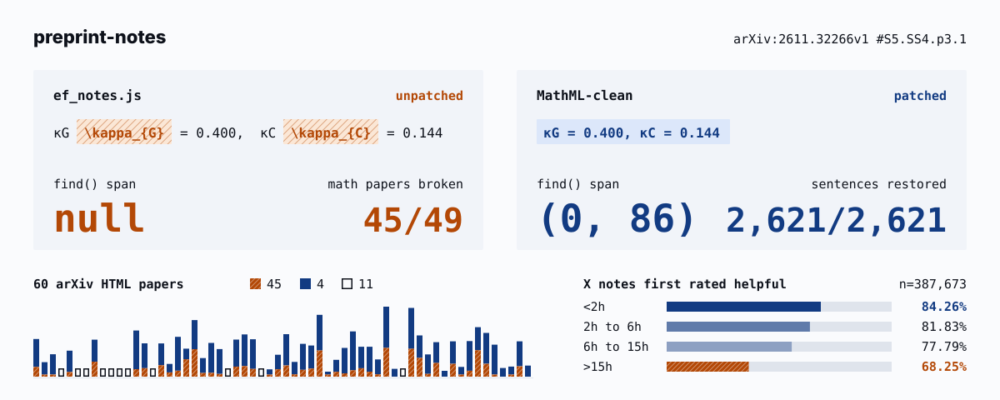

<picture>
  <source media="(prefers-color-scheme: dark)" srcset="assets/hero-dark.svg">
  
</picture>

# preprint-notes

Select any sentence in a real arXiv paper and watch the anchor break and get fixed live: [logxio.github.io/preprint-notes](https://logxio.github.io/preprint-notes/).

`ef_notes.js` (lines 37 to 67 on `epistemic.fund/notes.js`) builds its DOM text index with `TreeWalker(NodeFilter.SHOW_TEXT)` and skips only `script, style, [hidden]`. On `arxiv.org/html` (LaTeXML) papers, inline `<math>` blocks embed `<annotation encoding="application/x-tex">` hidden via CSS `display:none` without a `[hidden]` attribute, which splices raw TeX into the normalized text index.

Across all 60 reachable HTML papers from the 80 newest November 2026 `export.arxiv.org` submissions (`cs.HC`, `cs.CY`, `stat.AP`, `q-bio.QM`), 49 contain inline `<math>` and unpatched `ef_notes.js` returns `None` on both exact and 6-word `1.5x` fallback matching in 45 of them (91.8%, breaking 2,621 of 8,472 sentences in math paragraphs). Stripping `<annotation>` and `<annotation-xml>` restores all 2,621 sentence spans. In `arXiv:2611.32266v1`, the checker flags `kappa_G = 0.400` mislabeled "moderate" in `#S5.SS4.p3.1` and `#S5.SS6.p1.1` even though the same paper labels `kappa_G = 0.389` "fair" in `#S5.SS6.p4.1` under Landis & Koch (1977) `[0.21, 0.40]`.

Run with Python 3.10+ standard library (0.04s on the bundled 3-paragraph excerpt, zero third-party packages):

```bash
python3 preprint_note_check.py --demo
```

Verbatim output:

```text
[1/3] Common Notes ef_notes.js Anchor Test (arXiv:2611.32266v1 #S5.SS4.p3.1)
  reader_selection : Cohen’s linear-weighted kappa values are reported in Table III (κG = 0.400, κC = 0.144).
  ef_notes.js match: None (FAIL: hidden <annotation> TeX pollutes TreeWalker)
  patched match    : (0, 86) (OK, sha256=3e2b37b0419a)

[2/3] Document Checks on arXiv:2611.32266v1 (2 findings)
  1. [landis_koch_threshold] #S5.SS4.p3.1: kappa=0.400 labeled 'moderate' -> Landis & Koch (1977) [0.21, 0.40] => 'fair' ('moderate' requires [0.41, 0.60])
  2. [landis_koch_threshold] #S5.SS6.p1.1: kappa=0.400 labeled 'moderate' -> Landis & Koch (1977) [0.21, 0.40] => 'fair' ('moderate' requires [0.41, 0.60])
  [synthetic_stat_units.html self-check: 3/3 unit rules verified]

[3/3] X noteStatusHistory Observational Baseline (n=3,561,162, 387,673 first-CRH)
  snapshot status  : 76.97% CRH, 23.03% NMR
  by time-to-CRH   : <2h: 84.26% | 2h_to_6h: 81.83% | 6h_to_15h: 77.79% | >15h: 68.25%
```

## CLI Modes and Bundled Files

1. `python3 preprint_note_check.py --html path/to/paper.html [--quote "..."]` strips MathML source annotations for DOM quote anchoring and checks Landis & Koch kappa intervals, exact one-tailed or two-tailed Student-t `p`-values via regularized incomplete beta, `k/N` ratios, and GRIM integer means. `fixtures/arxiv_2611_32266v1_sample.html` holds verbatim paragraphs `#S5.SS4.p3.1`, `#S5.SS6.p1.1`, and `#S5.SS6.p4.1` from `https://arxiv.org/html/2611.32266v1`; `fixtures/synthetic_stat_units.html` is an isolated synthetic unit-test fixture (`candidate_notes=[]`).
2. `python3 preprint_note_check.py --html path/to/paper.html --json` outputs paper-specific `candidate_notes` (`everything_item`, `everything_claim`, `everything_note` drafts) along with `model_completed` and `exception_type`.
3. `stickiness_summary.json` records observational retention computed from X's public 2026-11-24 `noteStatusHistory` archive (`https://ton.twimg.com/birdwatch-public-data/2026/11/24/noteStatusHistory/noteStatusHistory-00000.zip`, SHA256 `72aa7ef8e2fdb406697b7e9073b69f9f6ec8b3160ead4ae003515688808b5517`, 3,561,162 notes).

## License

MIT (`LICENSE`).
